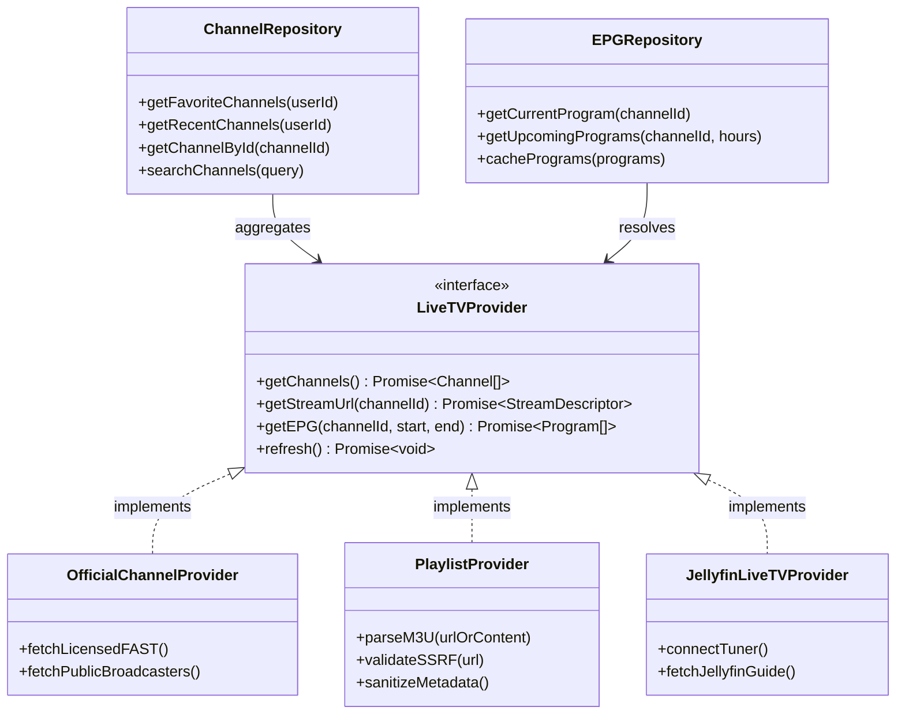
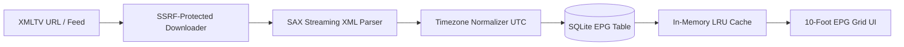

# STREAMLAB — LIVE TV ARCHITECTURE & FEASIBILITY SPECIFICATION
**Technical Architecture, Provider Abstractions, EPG Subsystem & Player Design**

* **Document ID:** ARCH-LIVETV-STREAMLAB-2026
* **Status:** ARCHITECTURAL SPECIFICATION & FEASIBILITY PLAN
* **Authority:** Principal Software Architect & Video Streaming Specialist
* **Target Release:** StreamLab v1.1.0

---

## 1. System Overview & Architectural Objectives

Live TV represents the evolution of StreamLab from an on-demand catalog viewer into a comprehensive, multi-device television platform. The architecture is engineered around three non-negotiable principles:
1. **Lawful & Sustainable:** Strict support for legitimate free-to-air, licensed FAST (Free Ad-supported Streaming TV), and user-owned tuners/playlists; zero tolerance for pirated scraping or cyberlockers.
2. **Provider-Agnostic Core:** Decoupled interfaces isolating channel metadata, Electronic Program Guide (EPG) schedules, and streaming transport protocols.
3. **High-Performance 10-Foot UI:** Instant channel switching (< 1.5s), responsive EPG timeline grid, and flawless D-pad focus routing on television remotes.

---

## 2. Core Provider Abstraction Model

To support diverse channel sources without coupling player UI to source-specific formats, the backend and client employ a unified provider interface:



### Component Definitions:
* **`LiveTVProvider` (Interface):** Defines the standard contract for channel enumeration, stream resolution, and program schedule querying.
* **`OfficialChannelProvider`:** Manages curated, licensed FAST feeds (e.g. public broadcasters, news feeds, public-domain television networks). Feeds are verified for legal distribution rights.
* **`PlaylistProvider` (User IPTV):** Parses user-imported M3U / M3U8 playlists and XMLTV EPG URLs. Operates under a strict security sandbox (SSRF validation, size limits).
* **`JellyfinLiveTVProvider`:** Interfaces with user self-hosted Jellyfin servers (HDHomeRun tuners, DVB-T, or SAT-IP tuner devices).
* **`ChannelRepository`:** Manages channel persistence, user favorites, channel numbers, and categorization in SQLite.
* **`EPGRepository`:** Manages program scheduling, time-window queries, and in-memory caching.

---

## 3. Electronic Program Guide (EPG) Subsystem

The EPG subsystem parses and indexes standard **XMLTV** format data and provides instant timeline lookups.

### A. Non-Blocking Ingestion Pipeline:


### B. Ingestion & Storage Architecture:
1. **Streaming XML Parser (SAX):** XMLTV files often exceed 50 MB. Rather than loading the complete DOM into memory (which causes Node.js OOM crashes), StreamLab utilizes a streaming SAX parser (`sax-js`) to ingest channels and programmes in a pipeline.
2. **Timezone Normalization:** All program timestamps (`start="20261101180000 +0530"`, `stop="20261101190000 +0530"`) are parsed and converted to ISO 8601 UTC before storage. The client translates UTC timestamps to the device's local timezone.
3. **Database Schema:**
   ```sql
   CREATE TABLE IF NOT EXISTS channels (
     id TEXT PRIMARY KEY,
     provider TEXT NOT NULL,
     channel_number INTEGER,
     name TEXT NOT NULL,
     logo_url TEXT,
     category TEXT DEFAULT 'General',
     stream_url TEXT NOT NULL,
     is_favorite INTEGER DEFAULT 0,
     sort_order INTEGER DEFAULT 0
   );

   CREATE TABLE IF NOT EXISTS epg_programs (
     id INTEGER PRIMARY KEY AUTOINCREMENT,
     channel_id TEXT NOT NULL,
     title TEXT NOT NULL,
     description TEXT DEFAULT '',
     start_utc TEXT NOT NULL,
     stop_utc TEXT NOT NULL,
     category TEXT DEFAULT '',
     poster_url TEXT DEFAULT '',
     FOREIGN KEY(channel_id) REFERENCES channels(id) ON DELETE CASCADE
   );
   CREATE INDEX IF NOT EXISTS idx_epg_timeline ON epg_programs(channel_id, start_utc, stop_utc);
   ```
4. **Non-Blocking Resilience Rule:** If EPG data is downloading, missing, or corrupt, **channel playback must never be blocked**. The UI gracefully falls back to displaying `"Program Information Unavailable"` while streaming starts immediately.

---

## 4. UI/UX Design for 10-Foot Leanback & Mobile

### A. Navigation Architecture:
* **Dedicated Navigation Tab:** A new `"Live TV"` tab is integrated into the bottom tab navigator (Mobile) and sidebar rail (Android TV / Fire TV).
* **EPG Timeline Grid:**
  * **Vertical Axis:** Channel list with channel number, logo, and current live badge.
  * **Horizontal Axis:** 30-minute time intervals across a 24-hour window.
  * **Focused Program Card:** Displays detailed synopsis, category chips, duration progress bar, and "Watch Now" action.
* **Mini-Player / Picture-in-Guide:** When browsing the EPG, video playback continues in a top-right or background overlay without audio interruption.

### B. Channel Surfing & TV Remote Mapping:
* **D-pad Up / Down:** Next / Previous channel with instantaneous audio crossfade and video pipeline pre-warming.
* **D-pad Left / Right:** Rewind / Forward in time on the EPG timeline.
* **Number Pad:** Direct channel number entry (e.g. typing `1`, `0`, `4` jumps to Channel 104 after a 700ms debounce).
* **OSD Auto-Hide:** Channel info banner auto-hides after 4.0 seconds of inactive remote control.

---

## 5. Video Streaming Engine Capabilities & Platform Nuances

Live streams operate under different constraints than static VOD files:

| Streaming Capability | Android Mobile | Android TV / Fire TV | iOS Mobile | Apple TV (tvOS) |
| :--- | :---: | :---: | :---: | :---: |
| **HLS (HTTP Live Streaming)** | Native ExoPlayer | Native ExoPlayer | Native AVPlayer | Native AVPlayer |
| **MPEG-DASH** | Supported | Supported | Limited (requires HLS mux) | Limited |
| **Live Low-Latency Tuning** | Handled | Handled | Handled | Handled |
| **Audio Track Selection** | Multilingual | Multilingual | Multilingual | Multilingual |
| **Closed Captioning (CEA-608/708)**| Supported | Supported | Supported | Supported |
| **Hardware HEVC Decoding** | Hardware Assisted | Hardware Assisted | Apple Silicon | Apple Silicon |

### Live Buffer Tuning:
To minimize channel change latency without incurring frequent rebuffering on variable broadband:
* `minBufferMs`: 2,500 ms (2.5 seconds minimum buffer to initiate playback).
* `maxBufferMs`: 10,000 ms (10 seconds maximum buffer ceiling).
* `bufferForPlaybackMs`: 1,200 ms (starts playback after 1.2s of video loaded).
* `bufferForPlaybackAfterRebufferMs`: 2,500 ms.
