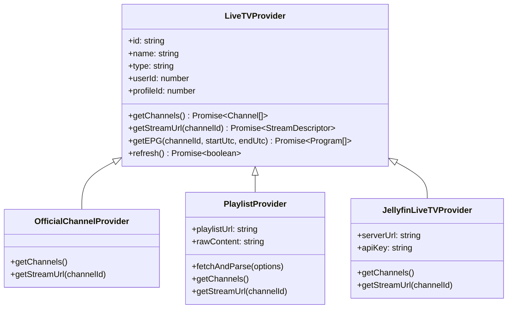

# STREAMLAB — LIVE TV PROVIDER IMPLEMENTATION SPECIFICATION
**Phase 16 Core Implementation: Interfaces, Contracts & Provider Subsystem**

* **Document ID:** IMPL-LIVETV-PHASE16-2026
* **Status:** IMPLEMENTED & TEST-VERIFIED
* **Branch:** `feat/phase-16-live-tv-foundation`
* **Target Version:** StreamLab v1.1.0

---

## 1. Provider Abstraction Architecture

The Live TV subsystem decouples the video playback engine from underlying media playlist formats and ingestion protocols. The implementation resides in `server/src/livetv/providers.js`:



### Component Contracts:
1. **`LiveTVProvider` (Base Class):**
   * Encapsulates common ownership attributes (`userId`, `profileId`).
   * Mandates subclass implementation of `getChannels()` and `getStreamUrl(channelId)`.
2. **`OfficialChannelProvider`:**
   * Delivers verified, lawful public domain and public broadcaster feeds (e.g. NASA TV, DW English, France 24).
   * Feeds are hardcoded with known reliable Akamai/Cloudflare HLS endpoints.
3. **`PlaylistProvider`:**
   * Ingests M3U / M3U8 playlists from remote URLs or inline text submissions.
   * Remote URLs are executed via `secureFetch` with strict SSRF defenses and 5 MB byte streaming limits.
   * Executes bounded streaming line-by-line parsing (`parseM3U`).
4. **`JellyfinLiveTVProvider`:**
   * Pre-configured contract for self-hosted Jellyfin instances.
   * Resolves Live TV channels and passes authenticated session tokens in `X-Emby-Token` headers.

---

## 2. Channel Data Contract

Every channel emitted by any provider conforms to the standard channel descriptor:

```typescript
interface ChannelDescriptor {
  id: string;               // Unique ID, e.g. ch_prv_123_1
  providerId: string;       // Foreign key to live_tv_providers
  channelNumber: number;    // LCN (Logical Channel Number)
  name: string;             // Display name (e.g. "NASA TV HD")
  logoUrl?: string;         // Remote or local PNG/SVG logo URI
  category: string;         // e.g. "News", "Sports", "General"
  streamUrl: string;        // HLS (.m3u8), DASH (.mpd), or MP4 stream URI
  tvgId?: string;           // XMLTV EPG channel identifier
  isFavorite?: boolean;     // Profile-scoped favorite status
}
```

---

## 3. Account-Scoped Persistent Job Management

To prevent resource exhaustion from duplicate concurrent playlist imports, `ImportJobManager` (`server/src/livetv/repository.js`) implements database-backed job locking:

* **Lock Acquisition:**
  * Checks `epg_sync_jobs` for an active job (`status = 'running' AND expires_at >= datetime('now')`).
  * If active, rejects new requests with HTTP 429 `IMPORT_IN_PROGRESS`.
  * If no active job or previous job expired, creates a new job record with a 60-second TTL.
* **Stale Lock Recovery:**
  * Any job remaining in `status = 'running'` past `expires_at` is automatically updated to `status = 'failed'` with `error_message = 'STALE_LOCK_RECOVERED'`.
