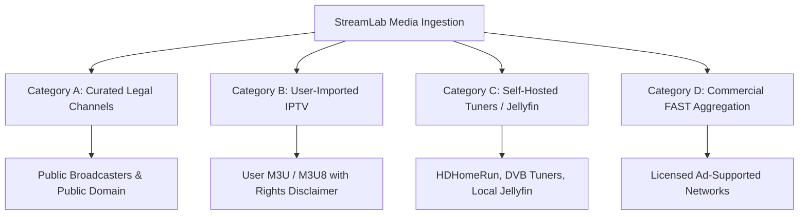

# STREAMLAB — STREAMING PROVIDER STRATEGY & COMPLIANCE FRAMEWORK
**Legal Sourcing, Content Taxonomy, User Import Governance & Anti-Piracy Architecture**

* **Document ID:** STRAT-PROVIDER-STREAMLAB-2026
* **Status:** APPROVED STRATEGY
* **Authority:** Principal Software Architect & Product Legal Compliance Lead

---

## 1. Executive Strategy & Ethical Foundation

StreamLab is engineered as a **premier, lawful, multi-device media player and aggregation platform**. Unlike predatory streaming applications that rely on illicit scraping, torrent cyberlockers, or pirated IPTV indexes, StreamLab's product vision is grounded in technical excellence, legal compliance, and user-owned content sovereignty.

---

## 2. Content Source Categorization & Ingestion Taxonomy

StreamLab organizes all playable content into four distinct, strictly governed tiers:

### Category A: Curated Free & Legal Public Streams
* **Scope:** Free-to-Air (FTA) public broadcasters (e.g. DD News, Parliament TV, NASA TV, DW, France 24), public-domain movie/documentary networks, and licensed open-access educational feeds.
* **Ingestion Model:** Maintained directly in the StreamLab server database (`featured` and `channels` tables). URLs point exclusively to official, publicly authorized distribution manifests.
* **Liability & Rights:** Verified to permit public internet distribution and non-commercial aggregation.

### Category B: User-Imported IPTV Playlists (BYOP - Bring Your Own Playlist)
* **Scope:** Enables power users to import their legitimate IPTV subscriptions, ISP television feeds, or custom M3U/M3U8 playlists.
* **Ingestion Model:** Imported via user settings (`POST /api/iptv/import`). The application stores playlist URLs and channel metadata in the user's isolated profile.
* **Legal Governance & User Responsibility:**
  * When importing, the UI presents an explicit **Content Rights & Responsibility Acknowledgement**:
    > *"By importing this playlist or stream URL, you acknowledge that you possess the lawful right, subscription, or license to access these channels. StreamLab does not provide, host, or index these streams and assumes no liability for user-imported content."*
  * User playlists are **never** shared across users or published to public discovery feeds.

### Category C: Self-Hosted Jellyfin & Local Hardware Tuners
* **Scope:** Connects to user-owned media servers running Jellyfin, Emby, or Plex, including Live TV tuners (HDHomeRun, DVB-T2, SAT-IP).
* **Ingestion Model:** Local LAN authentication via API keys. Tuner channel mappings and live transcode feeds stream directly from the user's local server.
* **Legal Governance:** 100% compliant private personal use.

### Category D: Future Commercial FAST Channel Partnerships
* **Scope:** Future integration with licensed FAST aggregators and channel syndicators (e.g. Plex Channels, Rakuten TV, DistroTV, localized Indian regional FAST networks).
* **Ingestion Model:** Programmatic API integration governed by formal commercial syndication agreements, incorporating Server-Side Ad Insertion (SSAI).

---

## 3. Strict Anti-Piracy Boundaries (Non-Negotiable Rules)

StreamLab explicitly refuses to implement, facilitate, or tolerate the following mechanisms:

1. **No Scraping of Commercial Streaming Services:** The platform will never extract, rip, or reverse-engineer streams from Netflix, Prime Video, Disney+ Hotstar, JioCinema, or similar subscription services.
2. **No Torrent / P2P Streaming Engine:** BitTorrent client engines (`webtorrent`, `libtorrent`) are strictly prohibited due to inherent copyright infringement and legal risks.
3. **No Cyberlocker or MovieBox Scraping:** No scrapers targeting illegal cyberlockers, streaming link repositories, or pirate API aggregators.
4. **No DRM Circumvention:** StreamLab will never bypass, disable, or decrypt Widevine, FairPlay, or PlayReady digital rights management systems.
5. **No Public Pirate Playlist Curation:** StreamLab will never ship with pre-loaded pirated M3U playlists containing unauthorized re-broadcasts of pay-TV channels.

---

## 4. Technical Guardrails for Ingestion & Delivery

1. **Client-Direct Streaming:** The StreamLab server acts as a metadata catalog and scheduler; it **never proxies video bytes**. Media manifests and video chunks stream directly from the authorized broadcaster or user server to the client player. This prevents server bandwidth bottlenecks and legal liability.
2. **Server-Side Security Validation:** User-provided M3U and EPG URLs undergo rigorous Server-Side Request Forgery (SSRF) checks prior to metadata fetching (see [LIVE_TV_SOURCE_SECURITY.md](file:///D:/AI_APPs/VIDEO_STREAMING_APP/streamlab-app/docs/security/LIVE_TV_SOURCE_SECURITY.md)).
