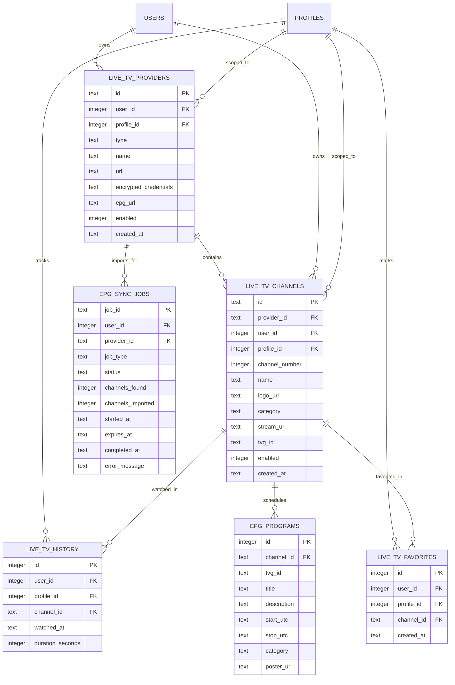

# STREAMLAB — LIVE TV DATABASE SCHEMA & MIGRATION SPECIFICATION
**Relational Data Model, Foreign Key Integrity, Indexing & Rollback Strategy**

* **Document ID:** DB-SCHEMA-PHASE16-2026
* **Status:** IMPLEMENTED & TEST-VERIFIED
* **Source Implementation:** `server/src/livetv/migrations.js`
* **Test Verification:** `server/test/livetv.test.js` (Test 3)

---

## 1. Schema Entity Relationship Diagram

The Live TV database architecture strictly enforces user and profile ownership to prevent multi-tenant data leakage:

---

## 2. Table Specifications & Index Strategy

### 1. `live_tv_providers`
* Tracks user-configured Live TV sources (`playlist`, `official`, `jellyfin`).
* **Cascade Delete:** Deleting a provider automatically removes all associated channels, favorites, and schedule programs via `ON DELETE CASCADE`.

### 2. `live_tv_channels`
* Normalized channel definitions.
* **Indexes:**
  * `idx_live_tv_channels_provider` on `(provider_id)`
  * `idx_live_tv_channels_profile` on `(user_id, profile_id)`
  * `idx_live_tv_channels_category` on `(category)`

### 3. `live_tv_favorites`
* Profile-scoped favorite flags.
* **Unique Constraint:** `UNIQUE(profile_id, channel_id)` prevents duplicate favorites.

### 4. `live_tv_history`
* Chronological watch history for recently-watched channel rails.
* **Index:** `idx_live_tv_history_profile` on `(profile_id, watched_at DESC)` for sub-millisecond retrieval of the last 10 channels.

### 5. `epg_programs`
* Program timeline schedule indexed by UTC timestamps.
* **Index:** `idx_epg_programs_channel_time` on `(channel_id, start_utc, stop_utc)`.

### 6. `epg_sync_jobs`
* Persistent job locking table ensuring no duplicate concurrent imports execute for the same user account.
* **Index:** `idx_epg_sync_jobs_active` on `(user_id, status, expires_at)`.

---

## 3. Transactional Migration & Safe Rollback Procedure

All schema changes are tracked in `schema_migrations` with version `20261101_01_livetv_foundation`:
* **Up Migration:** Executes within `db.transaction(...)`. WAL mode and foreign keys remain active.
* **Down Rollback:** Drops all created tables and deletes the version record cleanly in reverse dependency order. Tested and verified in `server/test/livetv.test.js`.
