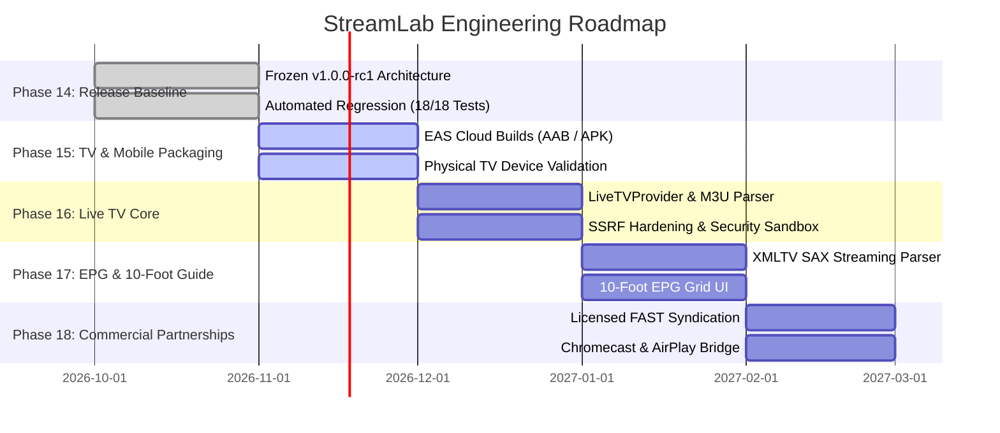

# STREAMLAB — PRODUCT ROADMAP & FEATURE CAPABILITY MATRIX
**Comprehensive Feature Audit, Gap Analysis & Phased Engineering Evolution**

* **Document ID:** ROADMAP-STREAMLAB-2026
* **Status:** MASTER PRODUCT ROADMAP
* **Authority:** Principal Software Architect & QA Automation Lead
* **Baseline Release:** v1.0.0-rc1

---

## 1. Feature Capability Audit Matrix

Features are audited with strict engineering discipline: separating verified implementations from work-in-progress, unvalidated UI, or planned capabilities.

### Domain 1: Content Discovery & Catalog
| Feature | Implementation Status | Code Evidence | Remaining Work | Complexity | Priority | Acceptance Criteria |
| :--- | :---: | :--- | :--- | :---: | :---: | :--- |
| **Hero Spotlight Banner** | **VERIFIED** | `Browse.js:45` | Auto-rotation interval tuning | Low | P1 | Displays featured media with backdrop, title, and Play CTA. |
| **Continue Watching Rail** | **VERIFIED** | `Browse.js:82`, `server.js:520` | Dynamic thumbnail preview | Medium | P0 | Shows media > 5% and < 95% complete with accurate progress bar. |
| **Multi-Language Search** | **VERIFIED** | `Search.js:35`, `server.js:634` | Search history chips | Medium | P0 | Debounced search queries proxying through server; < 200ms latency. |
| **Genre Browsing & Chips** | **PARTIAL** | `Browse.js:120` | Server-driven genre taxonomy | Low | P1 | Tapping chip filters home rail by selected genre. |
| **Advanced Search Filters**| **NOT IMPLEMENTED** | None | Year, rating, and language filter sheet | Medium | P2 | Users can filter by release decade, IMDb rating, and language. |
| **Similar Content Recs** | **PARTIAL** | `Details.js:210` | Recommendation ranking algorithm | High | P2 | Displays related titles based on TMDB collection and genre overlap. |
| **User Watchlist (My List)**| **VERIFIED** | `api.js:120`, `test 5` | Cloud backup & export | Low | P0 | Idempotent toggle; optimistic UI update; synced across devices. |

### Domain 2: Profiles & Family Controls
| Feature | Implementation Status | Code Evidence | Remaining Work | Complexity | Priority | Acceptance Criteria |
| :--- | :---: | :--- | :--- | :---: | :---: | :--- |
| **Multiple User Profiles** | **VERIFIED** | `Settings.js:150`, `server.js:483`| Custom avatar upload | Medium | P0 | Supports up to 5 profiles per account with isolated IDs. |
| **Profile Data Isolation** | **VERIFIED** | `server.js:540`, `tests 8 & 10` | Automated leak testing suite | High | P0 | Watch history and list queries strictly filter by `profile_id=?`. |
| **Kids Mode Content Filter**| **VERIFIED** | `server.js:614`, `test 11` | Custom rating thresholds | Medium | P0 | Automatically appends `include_adult=false&with_genres=10751,16`. |
| **Kids PIN Protection** | **VERIFIED** | `server.js:510`, `test 9` | Biometric unlock on mobile | Medium | P0 | 4-digit PIN required to exit Kids mode; rate-limited after 4 tries. |
| **Indian Regional L10n** | **VERIFIED** | `i18n.js`, `test 1` | Speech synthesis translation | Low | P1 | 10 regional languages supported with full key parity. |

### Domain 3: Video Player & Playback
| Feature | Implementation Status | Code Evidence | Remaining Work | Complexity | Priority | Acceptance Criteria |
| :--- | :---: | :--- | :--- | :---: | :---: | :--- |
| **Adaptive Bitrate (HLS)** | **VERIFIED** | `Player.js:40`, `react-native-video` | Manual resolution picker UI | Medium | P0 | ExoPlayer dynamically adjusts variant streams without stalls. |
| **Resume Playback Position**| **VERIFIED** | `Player.js:180`, `api.js:80` | Pre-roll resume prompt dialog | Low | P0 | Remembers second-exact timestamp and restores upon reload. |
| **Seek & Scrubbing (Mobile)**| **VERIFIED** | `Player.js:110` | Video frame scrubbing thumbnail | Medium | P0 | Double-tap seeks +/-10s; slider updates timeline instantaneously. |
| **Audio Track Selection** | **PARTIAL** | `Player.js:220` | Track metadata label mapping | Medium | P1 | User can switch between available audio tracks on multi-track HLS. |
| **Subtitle Selection** | **PARTIAL** | `Player.js:240` | External SRT/VTT parser | Medium | P1 | Displays CEA-608/708 or WebVTT subtitles with font scaling. |
| **Picture-in-Picture (PiP)**| **NOT IMPLEMENTED** | None | Native Android/iOS PiP bridge | High | P2 | App transitions to native floating window on Home gesture. |
| **Chromecast / AirPlay** | **NOT IMPLEMENTED** | None | Google Cast & AirPlay SDK bridge | High | P2 | Cast icon discovers receivers and routes stream playback. |

### Domain 4: 10-Foot Television Experience
| Feature | Implementation Status | Code Evidence | Remaining Work | Complexity | Priority | Acceptance Criteria |
| :--- | :---: | :--- | :--- | :---: | :---: | :--- |
| **D-Pad Spatial Navigation** | **VERIFIED** | `TVContainer.js`, `DpadFocus.js` | Physical TV remote latency test | High | P0 | Directional keys shift focus border with 1.08x scale transform. |
| **Overscan Margins (5%)** | **VERIFIED** | `TVContainer.js:20` | Settings overscan calibration slider | Low | P0 | UI enforces 48px horizontal & 27px vertical safe padding. |
| **TV Player Shortcuts** | **VERIFIED** | `Player.js:160` | Quick channel surfing overlay | Medium | P0 | Center button plays/pauses; Left/Right skips 10s/30s/60s. |
| **Leanback Launcher Icon** | **VERIFIED** | `app.json:28` | Android TV banner graphic | Low | P0 | Shows in Android TV launcher row under LEANBACK category. |

### Domain 5: Reliability & DevSecOps
| Feature | Implementation Status | Code Evidence | Remaining Work | Complexity | Priority | Acceptance Criteria |
| :--- | :---: | :--- | :--- | :---: | :---: | :--- |
| **Server-Side Token Revoke**| **VERIFIED** | `server.js:460`, `test 7` | Token blacklist cleanup cron | Medium | P0 | Immediate invalidation of all sessions on password change/logout. |
| **Database Online WAL Backup**| **VERIFIED** | `recovery.test.js`, `server.js:20` | Automated S3 offsite replication | Medium | P0 | Non-blocking snapshot backup via `db.backup()`. |
| **Network Interruption Retry**| **VERIFIED** | `api.js:25` | Offline cached browse feed | Medium | P1 | Axios backoff retry (1s, 2s, 4s) restores connection automatically. |
| **Structured Health Checks**| **VERIFIED** | `server.js:380`, `test 1` | Prometheus `/metrics` export | Low | P1 | `/api/health` returns status, uptime, memory, and database state. |

---

## 2. Phased Engineering Delivery Roadmap

