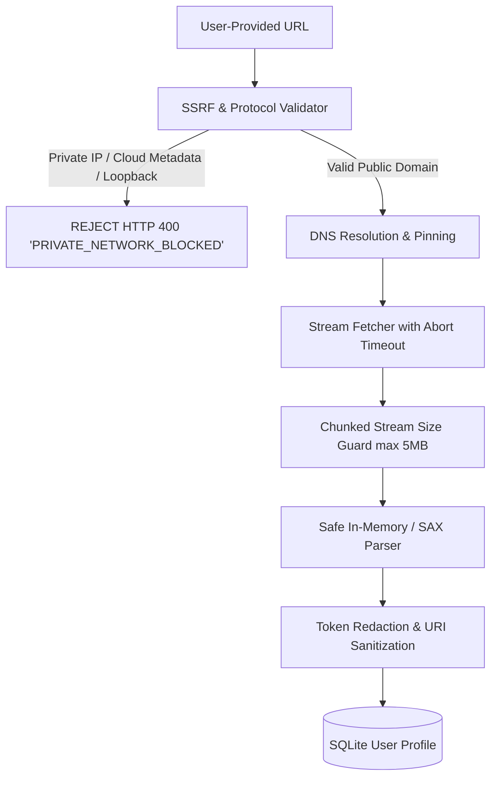

# STREAMLAB — LIVE TV SOURCE SECURITY & SSRF MITIGATION SPECIFICATION
**Threat Modeling, Egress Controls, Content Sandboxing & Defensive Architecture**

* **Document ID:** SEC-LIVETV-STREAMLAB-2026
* **Status:** MANDATORY SECURITY SPECIFICATION
* **Authority:** Principal Application Security Engineer & DevSecOps Lead
* **Scope:** User-Imported Playlists (M3U/M3U8), EPG XMLTV Fetching, Remote Stream Parsing

---

## 1. Threat Modeling for User-Supplied Streaming Feeds

Allowing users to submit arbitrary playlist URLs (`.m3u8`) and EPG endpoints (`.xml`) introduces critical security risks if the server fetches or processes those assets without strict defensive boundaries:



### Critical Vulnerabilities & Threat Vectors:
1. **Server-Side Request Forgery (SSRF):** Malicious users input `http://169.254.169.254/latest/meta-data/` (AWS/GCP cloud metadata) or `http://127.0.0.1:3000/api/admin/` to extract instance credentials or bypass authentication.
2. **DNS Rebinding Attacks:** Attacker controls a domain that resolves to a public IP during initial validation, then immediately switches its DNS record to `127.0.0.1` during the actual HTTP fetch.
3. **Denial of Service via Huge Payloads (Billion Laughs / Zip Bomb):** Malicious M3U playlists of 500 MB or recursive XMLTV files designed to exhaust backend RAM and crash Node.js.
4. **Credential Exposure in Audit Logs:** Commercial IPTV URLs frequently contain inline auth tokens (e.g. `http://provider.tv/live/user/pass/123.m3u8`). Logging these raw URLs compromises customer accounts.

---

## 2. Server-Side SSRF Defensive Implementation

To prevent SSRF and internal network scanning, any backend endpoint fetching remote feeds (`/api/iptv/import` or `/api/epg/sync`) must execute the following multi-stage verification:

### A. Protocol Whitelist:
* **Allowed:** Strictly `http:` and `https:`.
* **Prohibited:** `file:`, `ftp:`, `gopher:`, `dict:`, `data:`, `blob:`, `ldap:`.

### B. Prohibited IP & CIDR Ranges:
Prior to executing HTTP requests, the hostname must be resolved via `dns.lookup()`. Requests are immediately aborted if the resolved IP falls within:
* Loopback: `127.0.0.0/8`, `::1`
* RFC 1918 Private Networks: `10.0.0.0/8`, `172.16.0.0/12`, `192.168.0.0/16`
* Cloud Metadata Endpoints: `169.254.169.254`, `fd00:ec2::254`
* Link-Local / Carrier-Grade NAT: `169.254.0.0/16`, `100.64.0.0/10`
* IPv6 Unique Local (ULA): `fc00::/7`
* Multicast / Broadcast: `224.0.0.0/4`, `240.0.0.0/4`, `ff00::/8`

### C. Reference Node.js SSRF Guard Implementation:
```javascript
const ipaddr = require("ipaddr.js");
const dns = require("dns").promises;

async function validateSafeRemoteUrl(rawUrl) {
  let parsed;
  try {
    parsed = new URL(rawUrl);
  } catch {
    throw new Error("INVALID_URL");
  }

  if (parsed.protocol !== "http:" && parsed.protocol !== "https:") {
    throw new Error("UNSUPPORTED_PROTOCOL");
  }

  // Resolve hostname to IP to prevent DNS rebinding
  const lookup = await dns.lookup(parsed.hostname, { all: true });
  if (!lookup || lookup.length === 0) {
    throw new Error("DNS_RESOLUTION_FAILED");
  }

  for (const entry of lookup) {
    const addr = ipaddr.parse(entry.address);
    const range = addr.range();
    if (["loopback", "private", "linkLocal", "uniqueLocal", "carrierGradeNat", "broadcast"].includes(range)) {
      throw new Error("FORBIDDEN_PRIVATE_NETWORK");
    }
    // Block AWS/GCP/Azure link-local metadata explicitly
    if (entry.address === "169.254.169.254") {
      throw new Error("METADATA_ENDPOINT_BLOCKED");
    }
  }

  return parsed;
}
```

---

## 3. Resource Exhaustion & Payload Size Guards

To prevent memory crashes from unbounded playlists or XML bombs:

| Resource Type | Hard Ceiling | Enforcement Mechanism | Failure Response |
| :--- | :--- | :--- | :--- |
| **M3U / M3U8 File Size** | Maximum **5.0 MB** | Content-Length check & chunked byte counter | HTTP 413 `PAYLOAD_TOO_LARGE` |
| **Total Channel Count** | Maximum **2,000 channels** | Ingestion loop breaker | Ingests top 2,000; returns truncation warning |
| **XMLTV EPG File Size** | Maximum **25.0 MB** | Stream-level byte counter | HTTP 413 `EPG_TOO_LARGE` |
| **Fetch Timeout** | **8,000 ms** (8 seconds) | `AbortSignal.timeout(8000)` | HTTP 504 `UPSTREAM_TIMEOUT` |
| **Concurrent Imports** | 1 per user account | In-memory mutex / lock flag | HTTP 429 `IMPORT_IN_PROGRESS` |

---

## 4. Credential & Token Redaction in Logging

IPTV stream URLs frequently contain plaintext credentials (e.g., `http://example.com/live/username/password/123.m3u8`). StreamLab strictly implements **Redacted URI Masking** prior to persisting logs or database records:

```javascript
function redactStreamUrl(url) {
  try {
    const parsed = new URL(url);
    if (parsed.password) {
      parsed.password = "REDACTED";
    }
    // Match common IPTV path patterns /live/{user}/{pass}/
    const pathParts = parsed.pathname.split("/");
    if (pathParts.length >= 4 && pathParts[1] === "live") {
      pathParts[3] = "REDACTED";
      parsed.pathname = pathParts.join("/");
    }
    return parsed.toString();
  } catch {
    return "[MALFORMED_URI]";
  }
}
```

---

## 5. Third-Party Dependency Licensing Audit

Before introducing any new libraries for Live TV or XMLTV processing, licenses must be verified against commercial redistribution standards:

| Candidate Dependency | Intended Purpose | License | Compliance Verdict |
| :--- | :--- | :--- | :---: |
| `sax` | Streaming SAX XML parser for XMLTV | **ISC / MIT** | **APPROVED** (Permissive) |
| `ipaddr.js` | IP address and CIDR range validator | **MIT** | **APPROVED** (Permissive) |
| `iptv-playlist-parser` | Lightweight M3U/M3U8 parser | **MIT** | **APPROVED** (Permissive) |
| `webtorrent` / `libtorrent`| P2P Torrent Streaming | MIT / BSD | **PROHIBITED** (Anti-Piracy Rule) |
| `ffmpeg` native binaries | Transcoding wrapper | LGPL / GPL | **PROHIBITED** (Avoids GPL contamination) |
