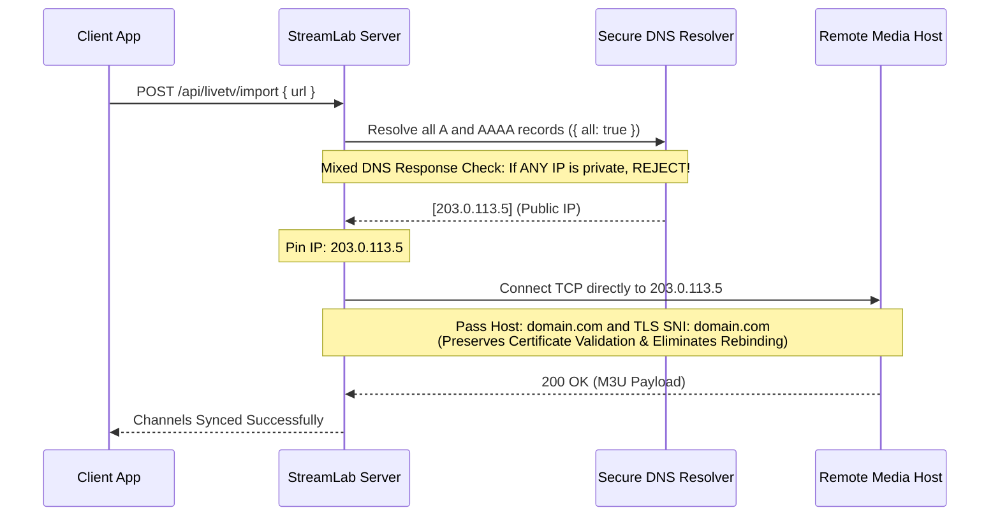

# STREAMLAB — LIVE TV SSRF IMPLEMENTATION & DEFENSE REPORT
**Outbound Network Egress Controls, IP Pinning & DNS Rebinding Immunity**

* **Document ID:** SEC-SSRF-PHASE16-2026
* **Status:** IMPLEMENTED & TEST-VERIFIED
* **Source Implementation:** `server/src/livetv/ssrf.js`
* **Test Verification:** `server/test/livetv.test.js` (Test 4)

---

## 1. Vulnerability Background & The Failure of Validation-Only Lookups

A common vulnerability in media aggregation backends is **Validation-Only DNS Lookup**:
1. Server receives URL `http://attacker-controlled.com/playlist.m3u`.
2. Server calls `dns.lookup("attacker-controlled.com")` ➔ receives `93.184.216.34` (Public IP, passes validation).
3. Server executes `fetch("http://attacker-controlled.com/playlist.m3u")`.
4. *Attack Vector (DNS Rebinding):* The attacker's authoritative nameserver responds with TTL=0 and switches the resolution to `127.0.0.1` or `169.254.169.254` during step 3. The server connects to the private network.

---

## 2. StreamLab Defensive Architecture: Pinned IP Outbound Transport

StreamLab defeats DNS rebinding by implementing a custom **Pinned IP Connection Protocol**:



### Key Technical Defenses:
1. **All-Record Resolution (`{ all: true }`):**
   * StreamLab resolves all IPv4 and IPv6 addresses.
   * If a malicious domain answers with both a public IP and a private fallback (Mixed DNS), the request is rejected with `FORBIDDEN_IP_RANGE`.
2. **Pinned IP Socket Lookup:**
   * In `http.request` / `https.request`, StreamLab injects a custom `lookup` handler:
     ```javascript
     lookup: (host, opts, cb) => {
       cb(null, pinnedIp, net.isIPv6(pinnedIp) ? 6 : 4);
     }
     ```
   * Node's socket layer connects directly to `pinnedIp`. Secondary DNS lookups are bypassed entirely.
3. **Preserved TLS SNI & Host Headers:**
   * The `Host:` HTTP header and TLS Server Name Indication (`servername`) retain the original hostname, ensuring HTTPS certificates are verified correctly.
4. **Recursive Redirect Validation:**
   * Redirects (301, 302, 303, 307, 308) are caught, intercepted, and routed back through `validateAndPinUrl` before following. A maximum of 3 redirects is enforced.
5. **Streaming Chunk Size Limit (5 MB):**
   * Response chunks are monitored via a running byte counter. If payload exceeds 5 MB (`5 * 1024 * 1024`), the socket is destroyed with `PAYLOAD_TOO_LARGE`.
6. **Strict 8-Second Total Timeout:**
   * `req.setTimeout(8000)` destroys hanging sockets.

---

## 3. Comprehensive IP Range Blocking Matrix

The following CIDR blocks are blocked at the application level:

| Target Subnet / Address | Designation | Threat Vector | Status |
| :--- | :--- | :--- | :---: |
| `127.0.0.0/8`, `::1` | Loopback | Local server port scanning / admin API access | **BLOCKED** |
| `10.0.0.0/8` | Private RFC 1918 | Corporate intranet scanning | **BLOCKED** |
| `172.16.0.0/12` | Private RFC 1918 | Docker / Kubernetes internal bridge network | **BLOCKED** |
| `192.168.0.0/16` | Private RFC 1918 | Local router & gateway access | **BLOCKED** |
| `169.254.169.254` | AWS / GCP / Azure Metadata | IAM credential extraction | **BLOCKED** |
| `169.254.0.0/16`, `fe80::/10` | Link-Local IPv4 / IPv6 | Neighbor node discovery | **BLOCKED** |
| `100.64.0.0/10` | Carrier-Grade NAT | ISP infrastructure probing | **BLOCKED** |
| `fc00::/7` | Unique Local IPv6 (ULA) | Private IPv6 subnets | **BLOCKED** |
| `224.0.0.0/4`, `ff00::/8` | Multicast | Network storm generation | **BLOCKED** |
| `file://`, `ftp://`, `gopher://`| Non-HTTP schemes | Local file disclosure (`/etc/passwd`) | **BLOCKED** |
